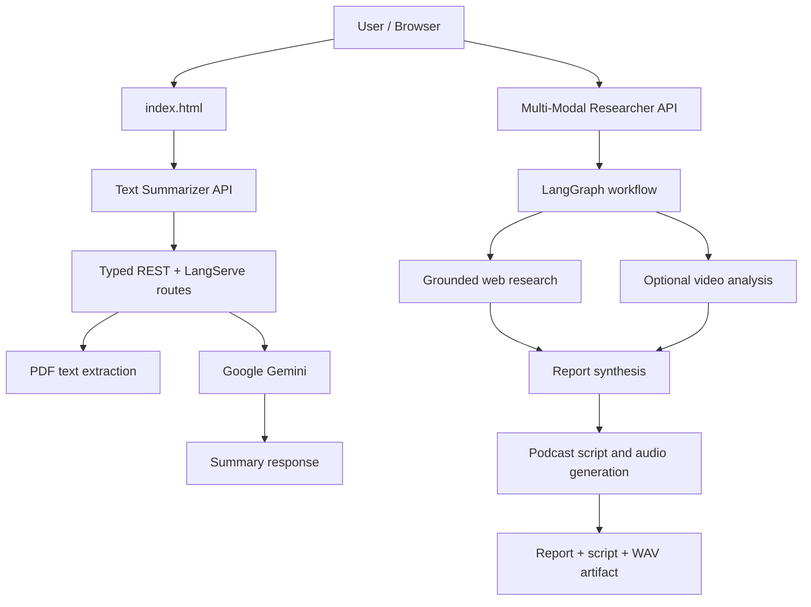

# Deployment Capstone

A repository for deploying and operating two AI application services, with a lightweight browser frontend and legacy implementations retained for reference.

## What is included

| Component | Purpose | Main technology |
|---|---|---|
| `services/langserve-text-summarizer/` | Typed API for summarizing text and PDF documents | FastAPI, LangServe, LangChain, Google Gemini |
| `services/multi-modal-researcher/` | Research workflow that can use web search and an optional video URL, then produces a cited report and podcast artifacts | FastAPI, LangGraph, Google Gemini |
| `index.html` | Browser UI for exercising the text-summarization API | HTML, JavaScript, Tailwind CSS CDN |
| `legacy-langserve-text-summarizer/` | Earlier summarizer implementation kept for reference | FastAPI, LangServe, LangChain |
| `legacy-multi-modal-researcher-using-langgraph/` | Earlier LangGraph researcher implementation and example artifacts | LangGraph, Gemini |

The `services/` directories contain the newer service-oriented implementations. Start and configure each service independently; this repository does not currently define a single root-level launcher or compose file.

## Architecture



## Requirements

- Python **3.11 or newer** (the multi-modal researcher package declares Python 3.11+).
- A Google Gemini API key with access to the models configured for the service.
- Git and a terminal.
- For the browser UI, a modern browser. The page loads Tailwind CSS from a CDN.

Never commit API keys or real secrets. Keep them in a local `.env` file or inject them through your deployment platform's secret manager.

## 1. Run the text-summarization service

From the repository root:

```bash
cd services/langserve-text-summarizer
python -m venv .venv
```

Activate the virtual environment:

**macOS/Linux**
```bash
source .venv/bin/activate
```

**Windows PowerShell**
```powershell
.venv\Scripts\Activate.ps1
```

Install the project and development/test dependencies:

```bash
python -m pip install --upgrade pip
python -m pip install -e ".[dev]"
```

Create a local `.env` file in this service directory:

```dotenv
GOOGLE_API_KEY=replace_with_your_gemini_api_key
GEMINI_MODEL=gemini-2.0-flash
HOST=0.0.0.0
PORT=8080
ENVIRONMENT=development
LOG_LEVEL=INFO
```

Start the API:

```bash
uvicorn app.main:app --host 0.0.0.0 --port 8080
```

Useful endpoints:

- Home / links: [http://127.0.0.1:8080/](http://127.0.0.1:8080/)
- OpenAPI / Swagger: [http://127.0.0.1:8080/docs](http://127.0.0.1:8080/docs)
- Health: `GET /health`
- Readiness: `GET /ready`
- Text summary: `POST /summarize/text`
- PDF summary: `POST /summarize-pdf`
- LangServe routes: `/summarize` (including its playground)

Example text request:

```bash
curl -X POST http://127.0.0.1:8080/summarize/text \
  -H "Content-Type: application/json" \
  -d '{"text":"Paste a document passage here."}'
```

The service validates inputs and includes request IDs in its response/observability design. Check `app/schemas/` and `app/api/routes.py` for the authoritative request/response contract.

### Browser frontend

Open `index.html` in a browser and set **API Base URL** to `http://localhost:8080` when using the newer service above. Choose an endpoint mode supported by the running backend. If you serve the page from a different origin, configure CORS appropriately; do not leave wildcard origins enabled in a production deployment unless that is an intentional, reviewed decision.

## 2. Run the multi-modal research service

Open a second terminal from the repository root:

```bash
cd services/multi-modal-researcher
python -m venv .venv
```

Activate the environment using the relevant command above, then install the package and its declared dependencies:

```bash
python -m pip install --upgrade pip
python -m pip install -e .
```

Create a local `.env` file in this service directory:

```dotenv
GEMINI_API_KEY=replace_with_your_gemini_api_key
HOST=0.0.0.0
PORT=8000
ENVIRONMENT=development
LOG_LEVEL=INFO
```

The configuration accepts `GEMINI_API_KEY` or `GOOGLE_API_KEY`; `GEMINI_API_KEY` takes precedence. Model defaults are defined in `app/core/config.py`; review them against the models enabled for your API key before deployment.

Start the API:

```bash
uvicorn app.main:app --host 0.0.0.0 --port 8000
```

Useful endpoints:

- OpenAPI / Swagger: [http://127.0.0.1:8000/docs](http://127.0.0.1:8000/docs)
- Health: `GET /health`
- Readiness and dependency checks: `GET /ready`
- Run research: `POST /research/run`
- Download generated audio: `GET /research/podcast/{filename}`

Example request:

```bash
curl -X POST http://127.0.0.1:8000/research/run \
  -H "Content-Type: application/json" \
  -d '{"topic":"Explain how large language models can act as a software platform"}'
```

The research request schema also supports an optional `video_url`. The workflow is intended to return a report, synthesis, podcast script and generated WAV filename. Actual results depend on credentials, API/model availability, network access and provider limits.

## 3. Tests and code quality

Run the summarizer test suite from its directory:

```bash
cd services/langserve-text-summarizer
python -m pip install -e ".[dev]"
pytest
```

Run the researcher test suite if/when tests are added to that service. At present, the repository tree shows a dedicated test suite for the summarizer service but does not show a corresponding `tests/` directory under `services/multi-modal-researcher/`.

Legacy summarizer tests can be run separately from `legacy-langserve-text-summarizer/` after installing that directory's `requirements.txt`. Legacy projects may have different dependencies and configuration; do not assume their runtime instructions apply to the newer `services/` implementations.

## Deployment and security notes

- Use a secrets manager or deployment environment variables for API keys. Do not put keys in source code, notebook outputs, screenshots, or commits.
- Restrict `CORS_ALLOW_ORIGINS` to trusted frontend origins in production.
- The services default to listening on `0.0.0.0` inside the runtime. Expose them only behind an appropriately configured firewall, reverse proxy or platform ingress; binding to all interfaces is not, by itself, authentication.
- Configure TLS, authentication/authorization, rate limiting, request-size limits, timeouts and provider-cost budgets before exposing endpoints publicly.
- Treat uploaded PDFs and generated reports/audio as potentially sensitive. Define retention, access control and deletion policies for your deployment.
- Avoid committing local `.env` files, virtual environments, generated artifacts or Python bytecode. The current repository includes legacy `__pycache__` files; consider removing tracked bytecode and keeping it excluded via `.gitignore`.
- Health and readiness endpoints are operational checks, not substitutes for end-to-end integration tests.

## Repository layout

```text
.
├── index.html
├── services/
│   ├── langserve-text-summarizer/
│   │   ├── app/
│   │   │   ├── api/
│   │   │   ├── core/
│   │   │   ├── schemas/
│   │   │   └── services/
│   │   ├── tests/
│   │   │   ├── integration/
│   │   │   └── unit/
│   │   ├── Dockerfile
│   │   └── pyproject.toml
│   └── multi-modal-researcher/
│       └── app/
│           ├── api/
│           ├── core/
│           ├── graph/
│           ├── schemas/
│           └── services/
├── legacy-langserve-text-summarizer/
└── legacy-multi-modal-researcher-using-langgraph/
```

## Project status

This README documents the repository structure and commands inferred from the checked-in source/configuration. The commands and endpoints have **not** been independently executed as part of this README update. Validate installation, tests, API-key permissions, model availability and deployment security in the target environment before treating a deployment as production-ready.

## License

See [LICENSE](LICENSE).
